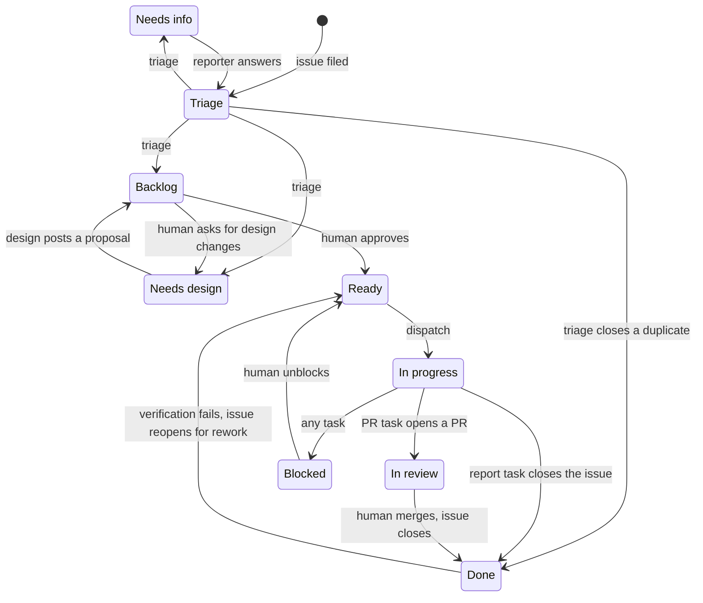
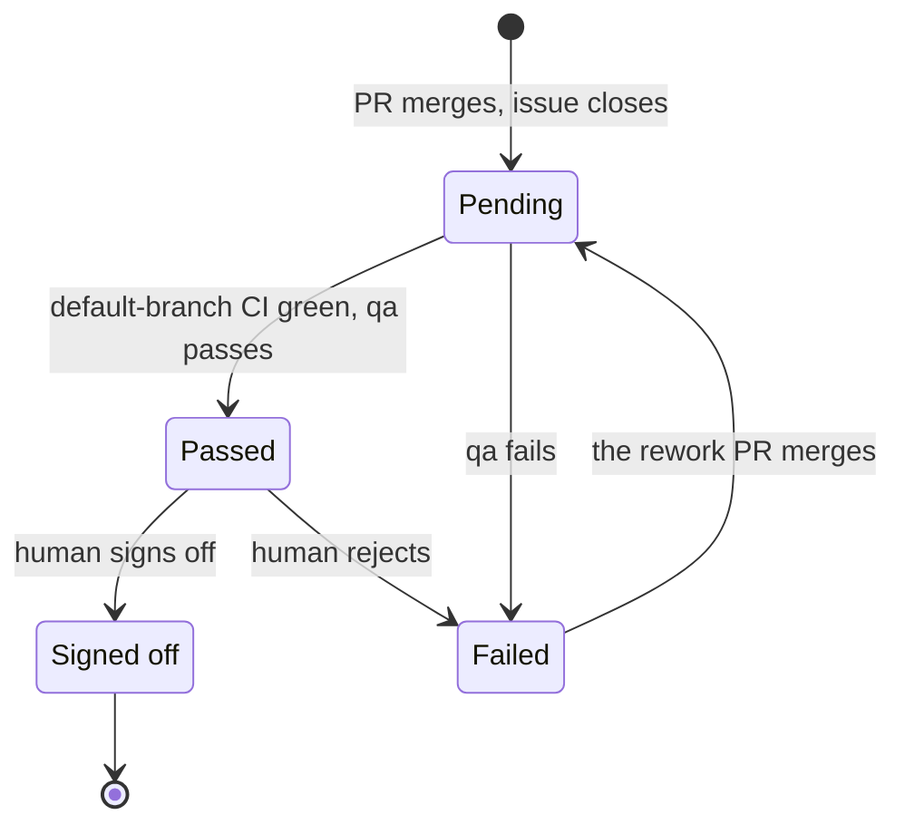
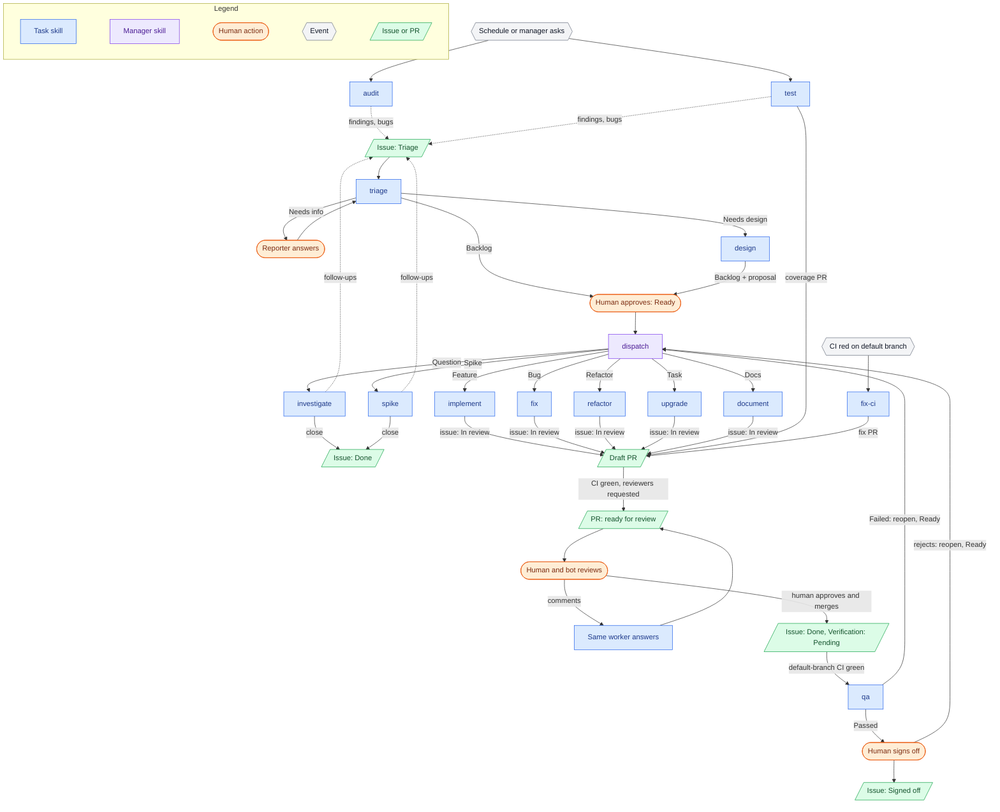

# Development process

The prototype process for managed development: work is tracked in GitHub
issues, a manager dispatches it, and workers carry it out one task per box.
The skills are stubs in `skills/`.

## Tracking model

Skills name these fields; the repository's tracker config maps them to issue
fields or labels, and only the `track` operation knows which. Issue fields
and types are set per organization; a repository outside one uses labels. A
GitHub Project is optional, as a board over the same fields.

| Field | Labels | Issue fields |
|---|---|---|
| Kind | `kind/bug`, `kind/feature`, `kind/task`, `kind/refactor`, `kind/docs`, `kind/question`, `kind/spike` | Issue type: Bug, Feature, Task (GitHub defaults) + Refactor, Docs, Question, Spike |
| Status | `status/triage`, `status/needs-info`, `status/needs-design`, `status/backlog`, `status/ready`, `status/in-progress`, `status/in-review`, `status/blocked`; closed = done | Status: Triage, Needs info, Needs design, Backlog, Ready, In progress, In review, Blocked; closed = done |
| Verification | `verify/pending`, `verify/passed`, `verify/failed`, `verify/signed-off` | Verification: Pending, Passed, Failed, Signed off |
| Priority | `priority/urgent`, `priority/high`, `priority/medium`, `priority/low` | Priority (GitHub default) |
| Effort | `effort/high`, `effort/medium`, `effort/low` | Effort (GitHub default) |
| Area | `area/*` | `area/*` labels |
| Owner | Assignee | Assignee |

One pinned **status issue** per repository, labelled `process/status`, holds
the current state of the work; the status skill keeps it up to date, and
dispatch and triage skip it.

## Status

Backlog always means "waiting for a human to approve". Dispatch assigns
every worker it launches (the lock), and moves Ready work to In progress.

| Status | Meaning | Set by |
|---|---|---|
| Triage | New, not yet assessed; an issue with no status counts | issue template label, or nobody |
| Needs info | Waiting on the reporter | triage |
| Needs design | Approach needs agreeing first | triage |
| Backlog | Assessed, waiting for a human to approve | triage, design, a second failed verification |
| Ready | Approved to do next; the only status work starts from | a human, or a failed verification (rework) |
| In progress | A worker is doing approved work | dispatch |
| In review | PR open | the task that opened it |
| Blocked | Waiting on something that isn't an issue: a person, access, an outside decision; always with a comment saying what | any task |
| Done | Closed: merged, answered, or a duplicate | merge / close-issue |

## Verification

Merged work is verified on the default branch after its issue closes: once
the merge commit's CI is green, dispatch launches a qa box; then a human
signs off. A failed verification reopens the issue as Ready, and dispatch
hands it back to its kind's task with the QA report as the brief; a second
failure sends it to Backlog for a human instead. A parent issue is verified
once more when its last sub-issue closes: dispatch closes it and sets
Verification → Pending, and qa checks the whole feature against its design
on the current default branch.

| Verification | Meaning | Set by |
|---|---|---|
| Pending | Merged; waiting for default-branch CI, then qa | the PR's worker, on merge; dispatch, for a parent |
| Passed | qa verified it; waiting for a human | qa |
| Failed | Doesn't work on the default branch; the issue is reopened as Ready for rework (Backlog on a second failure) | qa, or a human |
| Signed off | Accepted by a human | a human |

## Pull requests

The worker that opens a PR stays with it until it merges.

| Phase | PR state | What happens | Ends when |
|---|---|---|---|
| Build | Draft | The PR task opens a draft PR with `Fixes #N` and drives CI green | CI is green |
| Review | Ready for review | The worker marks it ready and requests reviewers (CODEOWNERS, else the tracker config's defaults); review bots comment; the worker answers human and bot comments and keeps CI green | A human approves |
| Merge | Approved | The worker rebases if a rebase point calls for it; the human merges (or a merge queue does) | Merged: the issue closes, the worker sets Verification → Pending and exits |

Rebase only when the next step needs it, never on a timer or because the
default branch moved:

| Rebase point | When |
|---|---|
| Before review | The PR conflicts |
| After approval | The PR conflicts, or the branch must be up to date and isn't |
| On request | A human asks |

Review bots are optional, configured per repository; when they are, the
PR's worker answers them like any reviewer. Only PRs opened by workers are
watched; PRs opened by humans, contributors or bots (Dependabot, Renovate)
are left to whoever submitted them.

## Relationships

GitHub-native, the same under labels or fields.

| Relationship | GitHub feature | Rule |
|---|---|---|
| Blocked by / blocking | Issue dependencies (`is:blocked`, `blocked-by:N`) | Work starts only from Ready and not `is:blocked`; closing the blocker frees it, no status change |
| Parent / child | Sub-issues | An issue with open sub-issues is a container, never dispatched; dispatch closes it when its children are done, which starts its verification |
| Issue ↔ PR | Closing keyword (`Fixes #N`) in the PR | Every PR task links its issue; merging closes it and starts verification |
| Duplicate | Close as duplicate | Triage closes duplicates against the original |

Splitting: design creates the sub-issues itself, in Backlog, each with its
kind, effort, acceptance criteria and dependencies, so the human approves
real issues. Approving moves them to Ready, all at once or a few at a time;
changes send the parent back to Needs design, and design edits, adds or
closes (as not planned) sub-issues. Discovered prerequisites: a task files the issue,
marks its own issue blocked by it, and stops with a report.

## Design docs

The repository's own docs carry its design and its review rules, and change
in the same PR as the code they describe.

| Doc | Read | Written |
|---|---|---|
| `DESIGN.md` | By every code task, root down to each package it touches (read-docs) | By the PR that changes the design, in the same change |
| `REVIEW.md` | Same; self-review and human reviewers check the change against it, and breaking a note is a finding | By the author: a bullet for a regression fixed, a mistake made twice, or something non-obvious |
| ADR (`docs/adr`) | By design, and by any task in an area an ADR covers | By design, in a PR, when a plausible alternative was rejected for a non-obvious reason: `Proposed` while in review; when the human approves the PR, design marks it `Accepted` and the human merges |

A task that would contradict an accepted ADR stops, and the issue goes back
to Needs design; ADRs are superseded, never edited.

## Human involvement

| Point | Required | What the human does |
|---|---|---|
| Approve work | yes | Move an issue from Backlog to Ready; Ready is the queue, in Priority order |
| Needs info | yes | The reporter answers; the issue goes back to Triage |
| Design proposal | yes | Review the proposal, its ADR PR and its sub-issues together; approve (approve the ADR PR, merge it once design marks it Accepted, move sub-issues to Ready) or ask for changes (→ Needs design) |
| Review and merge | yes | Review the PRs you're requested on; approve and merge, or request changes |
| Sign-off | yes | Read qa's report; sign off, or reject (→ Failed, issue reopens for rework) |
| File issues | no | Most work starts here; audit and test file issues too |
| Override triage | no | Change kind, priority or status |
| Blocked, access, questions | no | Unblock, grant credentials, answer what the manager can't |
| Rebase | no | Ask for one outside the rebase points |
| Release | no | Not part of the automated process |

## Tasks

| Skill | When (labels) | When (issue fields) | Output artifact | Sets | Must not |
|---|---|---|---|---|---|
| triage | `status/triage`, or no `status/*` label | Status = Triage | Issue comment with verdict and repro; failing test if possible | Kind, Priority, Effort; dependencies; closes duplicates; status → Backlog, Needs design or Needs info | Fix the issue |
| investigate | `kind/question` + `status/ready` | Type = Question, Status = Ready | Issue comment with the answer and evidence | closes the issue, or files follow-ups | Change code |
| design | `status/needs-design` | Status = Needs design | Proposal comment: approach, alternatives, files, risks; sub-issues in Backlog; an ADR PR (`Proposed`) when warranted, watched until it merges | status → Backlog; on PR approval, ADR → `Accepted` | Build before approval |
| spike | `kind/spike` + `status/ready` | Type = Spike, Status = Ready | Issue comment with findings, linking a throwaway branch | closes the issue; may file new ones | Open a PR to merge |
| implement | `kind/feature` + `status/ready` | Type = Feature, Status = Ready | PR (`feat`), `Fixes #N` | status → In review; Verification → Pending on merge | Go beyond the spec |
| fix | `kind/bug` + `status/ready` | Type = Bug, Status = Ready | PR (`fix`) with regression test, `Fixes #N`; a `REVIEW.md` bullet for a regression | status → In review; Verification → Pending on merge | Fix without reproducing first |
| refactor | `kind/refactor` + `status/ready` | Type = Refactor, Status = Ready | PR (`refactor`), `Fixes #N` | status → In review; Verification → Pending on merge | Change behavior |
| upgrade | `kind/task` + `status/ready` | Type = Task, Status = Ready | PR (`build` / `chore`), `Fixes #N` | status → In review; Verification → Pending on merge | Make unrelated changes |
| document | `kind/docs` + `status/ready` | Type = Docs, Status = Ready | PR (`docs`), `Fixes #N` | status → In review; Verification → Pending on merge | Change code |
| update-pr | A worker's PR needs its worker (comments, red CI, a rebase point) and the box is gone | same | The same PR, watched to merge | Verification → Pending on merge | Widen the PR's scope; rebase outside a rebase point |
| qa | `verify/pending` + CI green on the merge commit | Verification = Pending + CI green on the merge commit | Issue comment: QA report with evidence, from the default branch | Verification → Passed; or Failed, reopens the issue → Ready (Backlog on a second failure) | Fix what it finds |
| fix-ci | CI fails on the default branch | same | PR (`ci` / `test`) | none | Skip or retry tests to get green |
| test | Manager asks for coverage of an area | same | PR (`test`), plus an issue per bug found | new issues start at Triage | Fix the bugs it finds |
| audit | On a schedule, or when the manager asks | same | One issue per finding | new issues start at Triage | Fix the findings |

Rework: a reopened issue (Ready, Verification = Failed) goes to its kind's
task again, briefed with the QA report.

## Skills

### Groups

| Group | Rule | Lives in |
|---|---|---|
| Task | Has a trigger and returns an artifact; the manager hands one to one box | `skills/tasks` |
| Manager | Decides which tasks run, or deals with the human | `skills/manager` |
| Operation | One action inside a task or manager skill; no trigger, no artifact of its own | `skills/operations` |

### Manager skills

`start` is what the manager runs when it starts or restarts; it runs
dispatch, supervise and status.

| Skill | Runs when | What it does |
|---|---|---|
| start | The manager starts or restarts | Reconciles (live boxes; In progress issues and open worker PRs with no live worker go to update-pr or back to Ready), then loops: dispatch, supervise, status |
| setup | Once per repository, or when its setup is broken | Creates the issue types and issue fields (or labels), the status issue, and the tracker config |
| dispatch | Each pass of start | Matches issues and events to task triggers, takes Ready and not blocked, no open sub-issues, in Priority order; launches one worker each, assigns it, sets In progress; launches qa once a merge commit's CI is green; sends rework to its kind's task; closes a parent issue when its last sub-issue closes |
| supervise | Each pass of start, while workers run | Answers workers' questions and access requests, hands a dead worker's PR to update-pr, cleans up finished boxes |
| status | Each pass of start, when the state changed; or the human asks | Compares the state with the status issue's body and rewrites it if they differ: what waits on the human (Backlog to approve, PRs to review, sign-offs, blocked issues, stale PRs), and what is in progress; comments, mentioning the human, only for new items that need them |

### Operations

| Group | Operations | Used by |
|---|---|---|
| Tracking | track, open-issue, comment-issue, close-issue, link-issue | every task; start, dispatch, setup |
| Code | read-docs, commit, self-review, verify | every code task; verify also by fix, triage and qa |
| Delivery | open-pr, watch-pr | every PR task and update-pr |
| Coordination | report-back, request-access | every task |

## Open questions

- How the shipped skills map on: `triage-issue` → triage, `deliver-issue` →
  implement / fix, and whether `develop` goes or becomes the manager filing
  a Ready issue from a conversation.
